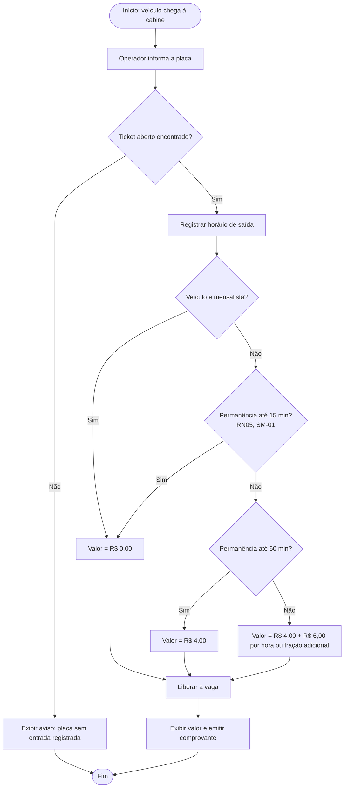
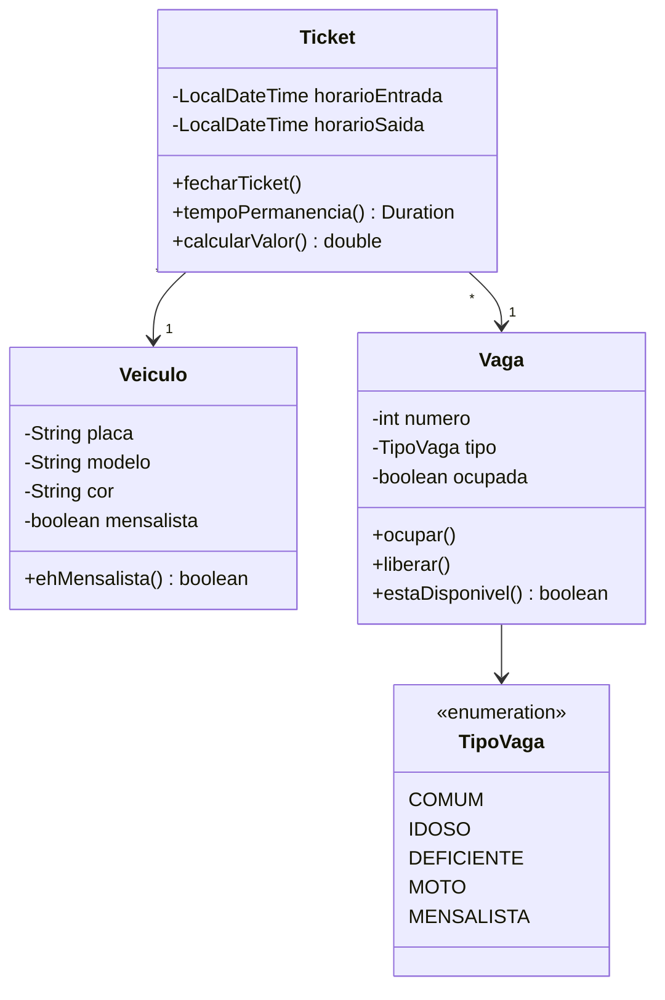
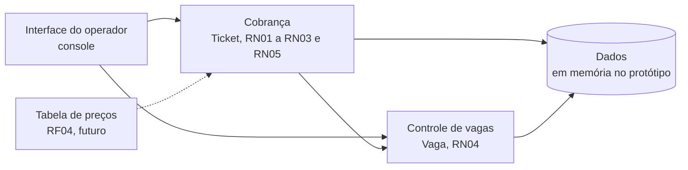

# 04. Modelagem, arquitetura e rastreabilidade (A9, A10)

## Fluxograma: registro de saída e cobrança (HU02, RF02)

**Ator:** operador de cabine. **Processo:** saída do veículo.

**Por que este modelo:** a cobrança tem decisões encadeadas (mensalista, tolerância, faixa de tempo). O fluxograma permitiu validar com o PO a ordem das regras antes de programar. A decisão da tolerância entrou na v1.1.0, com a SM-01.

## Diagrama de classes (conceitual, a partir do protótipo)

**Por que este modelo:** mostra onde cada regra mora. RN01 a RN03 ficam em `Ticket.calcularValor()`; RN04 deveria ficar entre `Ticket` e `Vaga` (veja o defeito D01 na pasta 05).

## Arquitetura conceitual

| Componente | Responsabilidade | Requisitos |
|---|---|---|
| Interface do operador | Entrada de placa e exibição do valor | RF01, RF02, RNF02 |
| Cobrança | Cálculo do valor pelas regras | RF02, RN01, RN02, RN03, RN05, RNF01 |
| Controle de vagas | Ocupar, liberar e contar vagas | RF03, RN04 |
| Dados | Guardar tickets, vagas e veículos | Todos |
| Tabela de preços (futuro) | Valores configuráveis | RF04 |

## Matriz de rastreabilidade

| Origem | HU | Requisito | Regra | Critério | Modelo | Componente | Testes | Mudança e versão |
|---|---|---|---|---|---|---|---|---|
| R03, R04 | HU02 | RF02 | RN01, RN02 | CA02 | Fluxograma de saída; classe Ticket | Cobrança | CT01 a CT05 | SM-01, v1.1.0 (CT09 a CT11) |
| R05 | HU02 | RF02 | RN03 | CA02 | Fluxograma de saída | Cobrança | CT06 | |
| SM-01 (pedido do PO) | HU02 | RF02 | RN05 | CA02 | Fluxograma de saída | Cobrança | CT09 a CT11 (não executados) | SM-01, v1.1.0 |
| R06 | HU01 | RF01 | RN04 | CA01 | Classes Ticket e Vaga | Controle de vagas | CT07, CT08 | |
| R07 | HU03 | RF03 | | | | Controle de vagas | Não coberto (Should, Incremento 2) | |
| R08 | HU04 | RF04 | | | | Tabela de preços | Não coberto (Could, Incremento 3) | DT-02 |
